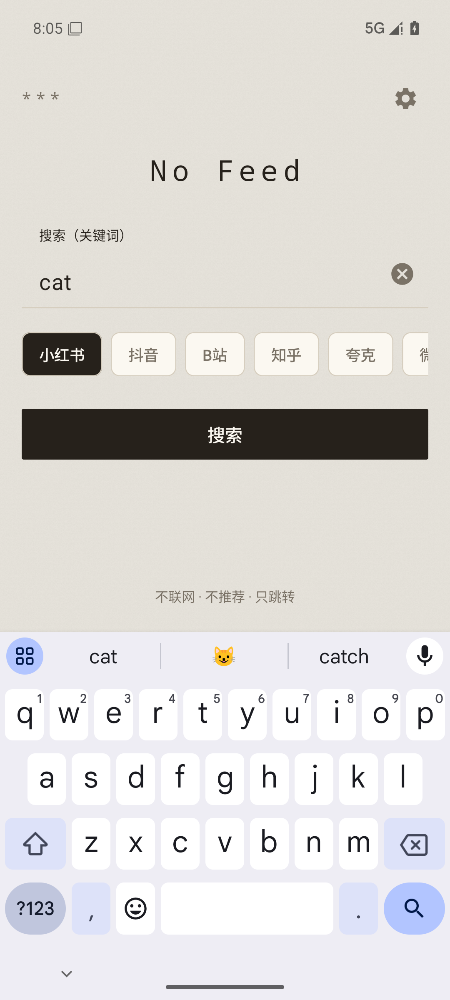
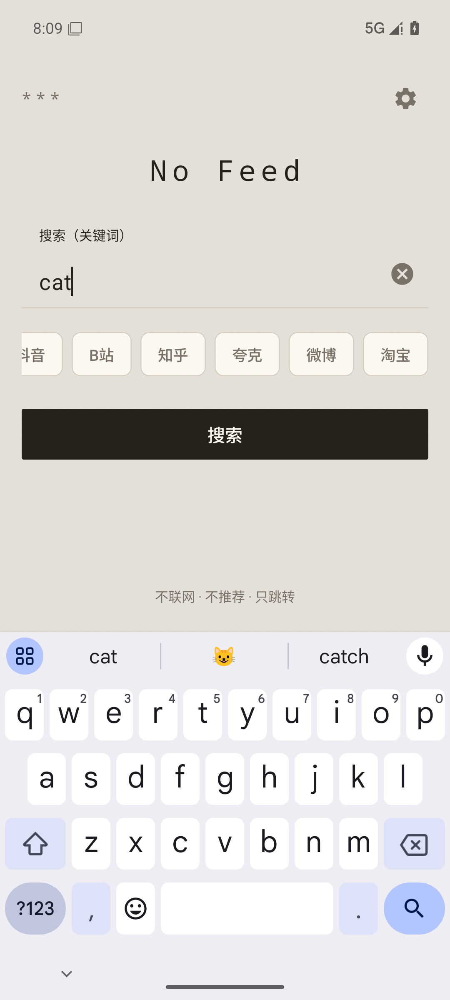
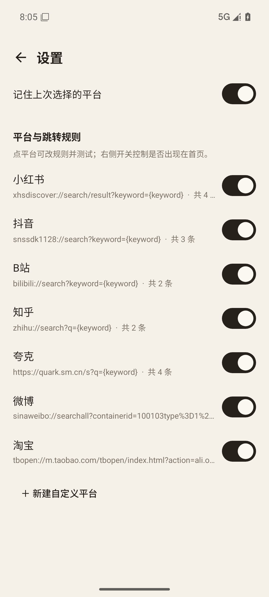
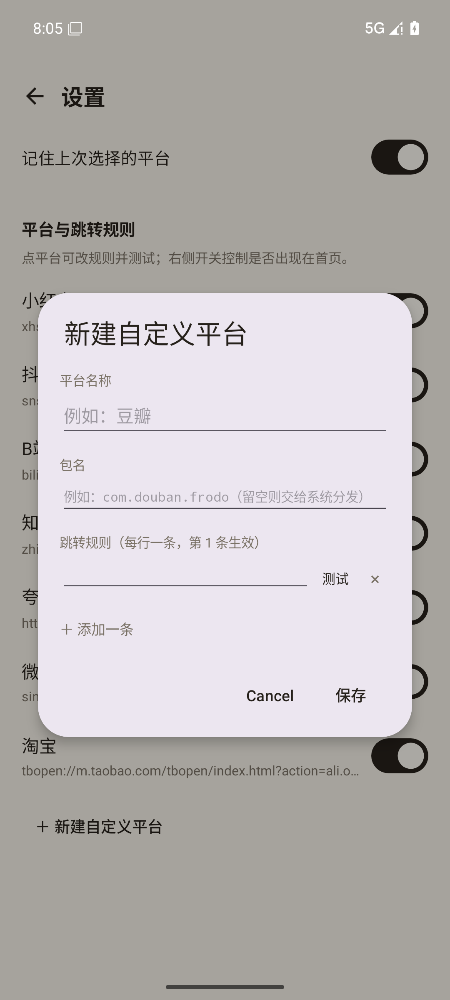
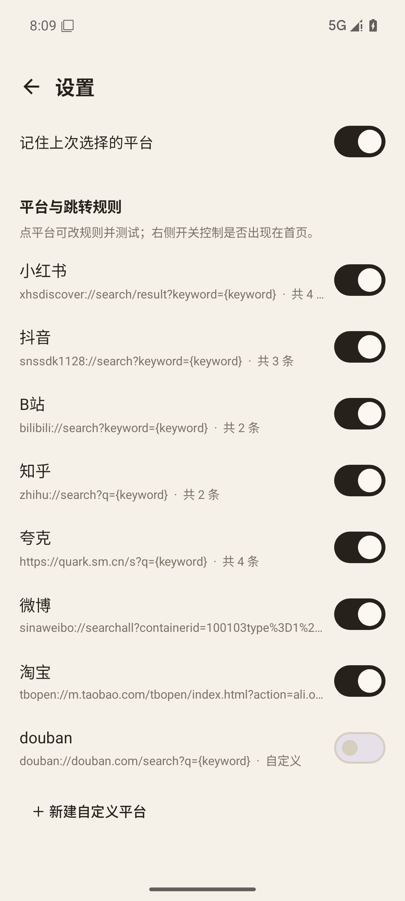

# 直搜（no feed dis）

[](https://github.com/gotocape/no-feed-dis/releases/latest)
[](LICENSE)
[](https://developer.android.com/about/versions/oreo)
[](#六红线自检)

一个把「打开 App → 被信息流绑架」变成「打开 App → 直接搜」的安卓工具。

**它不是搜索 App，是个跳转器。** 输入关键词、选平台、点搜索，它构造一个 Android Intent 唤起目标 App 的搜索结果页，然后自己退回后台。全程不抓取、不展示、不缓存任何第三方内容。

没有信息流、没有推荐、没有开屏广告、**没有 INTERNET 权限**——进程物理上无法联网。

---

## 界面

| 首页 | 隐藏部分平台 | 深色/纸质主题 |
|---|---|---|
|  |  |  |

| 新建自定义平台 | 自定义平台 + 显示开关 |
|---|---|
|  |  |

---

## 一、装到手机上

从 **[Releases](https://github.com/gotocape/no-feed-dis/releases/latest)** 下载 APK：

| 文件 | 体积 | 用途 |
|---|---|---|
| `no-feed-dis-v1.3-ace.apk` | 4.6 MB | **装这个**，release 构建 |
| `no-feed-dis-v1.3-ace-debug.apk` | 6.7 MB | 需要抓 logcat 时才用 |

签名相同、versionCode 都是 4，两者可以互相覆盖安装。

```bash
adb install -r no-feed-dis-v1.3-ace.apk
```

或者把 APK 传到手机，文件管理器点开安装（首次提示「未知来源」，允许即可）。

> 安装前建议核对 SHA256：`e0332aa3e3d12378469e972451a244fab715a87c94184b756df5c3d43f67230b`

---

## 二、怎么用

1. 打开「直搜」，光标已在输入框，键盘自动弹起
2. 打字
3. 点一个平台
4. 点「搜索」或键盘搜索键
5. 目标 App 结果页打开，直搜退到后台

返回直搜时**不会重弹键盘**，关键词还在。

---

## 三、v1.3 改了什么

### 1. 百度 → 夸克

百度被移除，换成夸克。夸克的规则有 4 条，第 1 条不是 scheme，而是**神马搜索的网页地址 + 包名限定**：

```
https://quark.sm.cn/s?q={keyword}
```

因为夸克本身是浏览器，对它来说「打开这个网址」等价于「进 App 搜这个词」，比猜 `quark://search` 这种不稳定的私有协议可靠得多。后面两条才是 scheme 尝试。

### 2. 自定义平台（新增）

设置页底部「＋ 新建自定义平台」，填三项就能加一个新平台：

| 字段 | 说明 |
|---|---|
| 平台名称 | 首页 Chip 上显示的字，最多 8 个字 |
| 包名 | 目标 App 的包名，留空则交给系统分发 |
| 跳转规则 | 每行一条，**第 1 条生效**，其余备用 |

保存前可以点每一行的「测试」，直接验证这条规则能不能跳。**新建时也能测** —— 不用先存一次再改。

自定义平台可以改名、改包名、改规则、整个删掉。内置平台只能改规则和隐藏，不能删。

### 3. 显示开关（新增）

设置页每个平台右侧一个开关，控制它**是否出现在首页**。

- 用不到的关掉，首页就干净
- 关闭顺序随意，随时打开
- 全部关掉时，首页显示「首页没有可用的平台，去设置里打开至少一个」

### 4. 首页视觉（新）

按参考图改成「一张纸」：

- 背景：暖白 `#F5F1E8` + 128×128 无缝噪点纹理（程序生成，14 KB）
- 左上角 `***`
- 正中 `No Feed`，等宽字体、字距拉开
- 搜索框：无底色无边框，只有一条底线 —— 像是直接在纸上写
- 平台 Chip：选中墨色实底，未选中透明 + 描边
- 深色模式：暗褐底 `#14120F` + 更低的纹理透明度

**功能一个字没改**：还是输入框 + 平台 + 搜索按钮，自动聚焦、清除按钮、键盘搜索键全部照旧。

---

## 四、跳转规则为什么会「只能打开 App 不能搜」

这是 v1.1 之前的核心问题，根因有两层。

### 第一层：startActivity 不告诉你到了哪个页面

```kotlin
startActivity(intent)   // 只要有任何 Activity 被启动，就成功返回
```

它只在**没有任何 Activity 能接收这个 URI** 时才抛 `ActivityNotFoundException`。如果 App 认这个 scheme、但路由表里没有这条 path，App 会正常启动停在首页，`startActivity` **照样返回成功**。

### 第二层：所以多 URI 候选不是自动降级

v1.0 的写法是「第一条失败试第二条」。但只要第一条能把 App 唤起来（哪怕只到首页），引擎判定成功，第二条永远没机会。

三个平台的表现差异就来自这里：

| | 抖音 | 小红书 | 微博 |
|---|---|---|---|
| scheme | `snssdk1128` | `xhsdiscover` | `sinaweibo` |
| 搜索路径 | `/search` ✅ 被认 | `/search` ❌，只有 `/search/result` 才是结果页 | `/searchall` 参数格式不对 |
| 关键词参数 | `?keyword=` 扁平 | `?keyword=` 扁平 | **嵌套**在 `containerid` 里 |
| 编码 | 1 次 | 1 次 | 可能要 2 次 |

抖音能用，纯粹因为它第一顺位那条恰好是对的。

**所以候选列表的真实语义是：第 1 条 = 生效，其余 = 备用/待验证。**

---

## 五、怎么把规则调对

因为上面说的限制，**没有程序能自动判断「这条 URI 是否真的到了搜索结果页」**。只能人眼确认一次。

**右上齿轮 → 点平台 → 每行都有独立「测试」按钮**

1. 点第一行「测试」→ 看是停在结果页还是首页
2. 不对就点第二行，再来
3. 找到对的那条，**挪到第一行**
4. 保存

### 三个占位符

| 占位符 | 含义 | 用在哪 |
|---|---|---|
| `{keyword}` | 编码一次 | 绝大多数平台 |
| `{keyword2}` | 编码两次 | 嵌套 query，如淘宝 `h5Url`、微博 `containerid` |
| `{keywordRaw}` | 不编码 | 极少数要原始值的场景 |

### 内置 7 个平台

| 平台 | 包名 | 首选规则 | 候选数 |
|---|---|---|---|
| 小红书 | `com.xingin.xhs` | `xhsdiscover://search/result?keyword=` | 4 |
| 抖音 | `com.ss.android.ugc.aweme` | `snssdk1128://search?keyword=` ✅已验证 | 3 |
| B站 | `tv.danmaku.bili` / 国际版 `com.bilibili.app.in` | `bilibili://search?keyword=` | 2 |
| 知乎 | `com.zhihu.android` | `zhihu://search?q=`（参数名是 q） | 2 |
| **夸克** | `com.quark.browser` | `https://quark.sm.cn/s?q=` | 4 |
| 微博 | `com.sina.weibo` | `sinaweibo://searchall?containerid=...%26q%3D` | 4 |
| 淘宝 | `com.taobao.taobao` | `tbopen://...h5Url=...search%3Fq%3D{keyword2}` | 4 |

> ⚠️ 除抖音外，所有 URI 都来自社区经验，未经真机验证。必须你在自己手机上按上面的流程逐条过一遍。

### 关于淘宝

旧写法 `taobao://s.taobao.com/search?q=` 淘宝 2019 年起就收紧了。现在走官方 `tbopen://` 协议：把 H5 地址整个 URL 编码后塞进 `h5Url`。因为 `h5Url` 里 `q=` 的值还要再编码一次，所以关键词用 `{keyword2}`。

已验证往返正确（`连衣裙 春款`）：

```
填入  : h5Url=...%3Fq%3D%25E8%25BF%259E...
解码  : https://s.taobao.com/search?q=%E8%BF%9E%E8%A1%A3%E8%A3%99%20%E6%98%A5%E6%AC%BE
页面取: 连衣裙 春款   ← 完全一致
```

### 关于 B 站国际版

大陆版 `tv.danmaku.bili` 的 URI 全部失败（通常就是没装）后，自动回落到国际版 `com.bilibili.app.in`。装哪个都能跳，不用手动选。

---

## 六、红线自检

| # | 检查项 | 结果 |
|---|---|---|
| R1 | manifest 无任何系统权限 | ✅ 见下 |
| R2 | 无网络库依赖 | ✅ 只有 core-ktx / appcompat / material |
| R3 | 无 WebView、无图片加载库 | ✅ 纹理是本地生成 PNG，不联网 |
| R4 | 无下拉刷新 | ✅ |
| R5 | 无「热门/推荐/猜你」文案与逻辑 | ✅ |
| R6 | 飞行模式功能完整 | ✅ 不声明 INTERNET |

**关于 `DYNAMIC_RECEIVER_NOT_EXPORTED_PERMISSION`**

`aapt2 dump permissions` 会列出这一条。它是 `androidx.core` 1.13+ 自动注入的自身签名级自定义权限，用于保护 App 内部动态广播接收器。不弹窗、不需授权、不授予任何系统能力，也无法移除。

**关键的是 `android.permission.INTERNET` 不存在。** 自己验证：

```bash
# 从 Releases 下载 APK 后
"$ANDROID_HOME/build-tools/36.0.0/aapt2" dump permissions no-feed-dis-v1.3-ace.apk
```

---

## 七、功能范围

**已实现**

- 大输入框 + 平台单选（自动记住上次选择）
- 跳转引擎：多包名 + 多 URI 候选 + 三种占位符编码 + 200 码点安全截断
- **平台可见性开关**
- **自定义平台增删改**
- 设置页：逐条测试、加行、删行、恢复默认
- 纸张质感首页 + 深浅色双配色
- Android 15/16 强制 edge-to-edge 适配

**没做**

- 搜索历史、桌面快捷方式、小组件、分享接收、预设词
- 平台排序（自定义平台固定排在内置之后）

---

## 八、自己编译

```bash
cd no-feed-dis
./gradlew assembleDebug
./gradlew assembleRelease
```

- Gradle 8.14.3（wrapper 已配腾讯云镜像）
- AGP 8.13.2 / Kotlin 2.0.21 / JDK 17
- compileSdk 36、minSdk 26（Android 8.0+）、targetSdk 36

重新生成纸张纹理（改了 seed 就是另一张纸）：

```bash
python tools/gen_paper_texture.py
```

---

## 九、工程结构

```
no-feed-dis/
├── app/src/main/
│   ├── AndroidManifest.xml          ← 零权限声明
│   ├── java/com/haijiao/nofeeddis/
│   │   ├── MainActivity.kt          ← 首页（渲染可见平台）
│   │   ├── SettingsActivity.kt      ← 设置页（开关 / 自定义 / 测试）
│   │   ├── PlatformRepository.kt    ← 内置+自定义合并、可见性过滤
│   │   ├── JumpEngine.kt            ← Intent 构造 + 编码 + 多包名
│   │   ├── Defaults.kt              ← 7 个内置平台
│   │   ├── Prefs.kt                 ← 本地存储（含自定义平台 JSON）
│   │   └── Platform.kt / Extensions.kt
│   └── res/
│       ├── drawable-nodpi/paper_texture.png   ← 程序生成的 14KB 纹理
│       ├── drawable/bg_paper.xml              ← 纸底 + 噪点叠加
│       └── color/chip_background.xml          ← Chip 选中/未选中
├── tools/gen_paper_texture.py       ← 纹理生成脚本（可复现）
├── dist/                             ← 本地编译产物落地处（APK 不进版本库）
└── docs/
    ├── 技术规格书.md                  ← 完整技术设计文档
    └── screenshots/                 ← README 配图
```

---

## 十一、许可证与免责

[MIT](LICENSE) © 2026 haijiao

本项目仅构造 Intent 唤起第三方 App，不访问、不解析、不存储任何第三方内容。各平台对第三方 deep link 的接受程度由其自身决定，随时可能变更；本项目不对跳转结果作任何保证。内置 URI 规则来自社区公开经验，与各平台官方无关。请自行评估使用风险。

---

## 十、已知限制

1. **无法自动判断是否到了搜索结果页。** 所以候选 URI 不是自动降级，第一条就是唯一生效的那条。
2. **无法在 UI 上把未安装的平台置灰。** 检测安装需要 `<queries>` 或 `QUERY_ALL_PACKAGES`，与零权限冲突。
3. **平台可能有白名单限制。** 小红书、微博、淘宝对第三方 deep link 的宽松度不同，理论上存在「任何 URI 都只能开首页」的版本。真遇到了这个方案就到底了。
4. **自定义平台不能排序**，固定排在内置平台之后。
5. **名称上限 8 个字**，超过会提示；这是为了让 Chip 不被撑爆。
